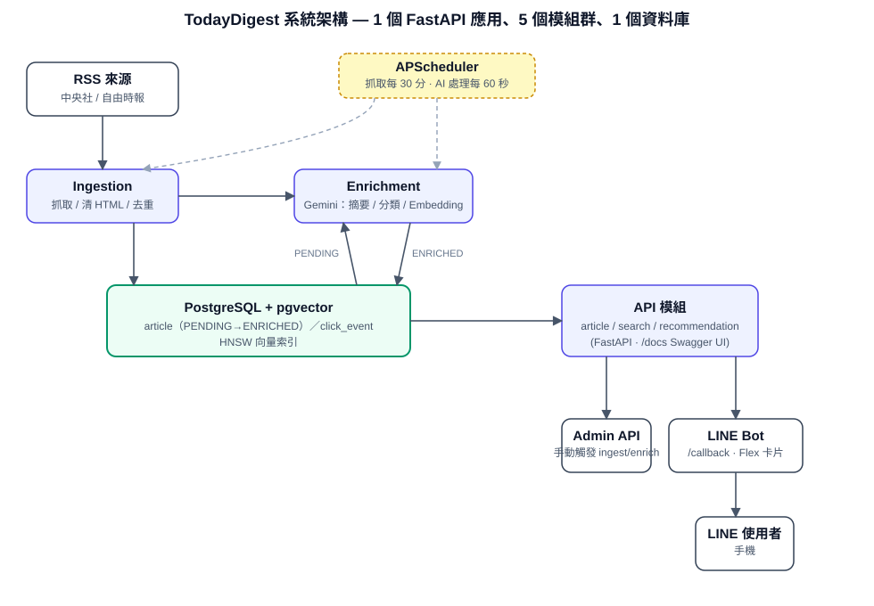

# TodayDigest

AI 新聞摘要 + 相關新聞 + LINE Bot（MVP）。詳細規格見 [docs/PRD.md](docs/PRD.md)。

## 架構

純後端服務（Python / FastAPI）：RSS 抓取 → LLM 摘要/分類/Embedding → pgvector 相關新聞 → LINE Bot / REST API。



## 啟動

```bash
cp .env.example .env   # 填入密鑰
docker compose up
```

啟動後：
- Swagger UI：http://localhost:8000/docs
- 健康檢查：http://localhost:8000/healthz

## API

見 `/docs`（Swagger UI）或 `/openapi.json`。主要端點列表見 [docs/PRD.md](docs/PRD.md#7-api-規格)。

## 測試

```bash
uv run pytest
uv run ruff check .
```

## Demo 影片

（待補連結）

## Future work

- 個人化推薦：以使用者點擊過的文章 embedding 平均當興趣向量，搭配時間衰減排序（`Recommender` 介面已預留）。
- Redis 快取、Prometheus/Grafana 監控、GitHub Actions CI。
- Spring Boot 版本：本專案的 API 以 OpenAPI（`/openapi.json`）定義，計畫用 Java 21 + Spring Boot 3 + Spring AI
  依同一份契約重寫（從 `linebot` 或 `search` 模組開始），比較兩種生態在開發速度、記憶體與啟動時間上的差異。
